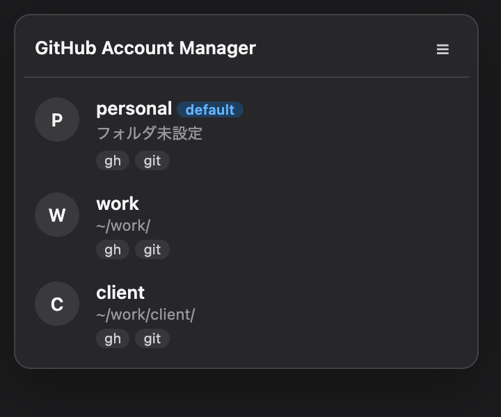
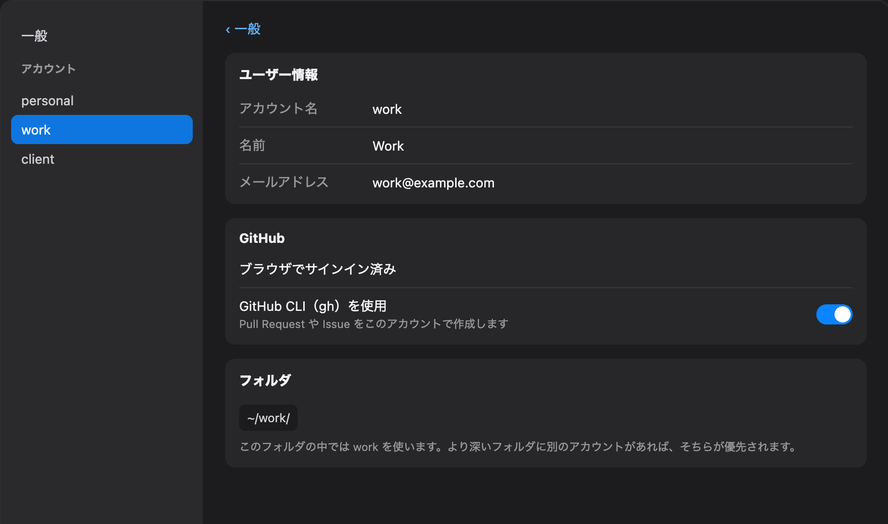

# GitHub Account Manager

フォルダごとに、Git と GitHub CLI のアカウントを切り替える Mac のメニューバーアプリです。個人、会社、取引先のように複数の GitHub アカウントを使っていても、今いるフォルダに応じてコミットの名前と認証先が決まります。

## 概要

このアプリは、ブランチを作ったり push したりしません。使うアカウントを決めるだけです。

- `git` は、リポジトリがあるフォルダでアカウントを決めます。
- `gh` は、コマンドを起動したフォルダでアカウントを決めます。
- 登録したフォルダの中では、そのアカウントを使います。フォルダが重なるときは、より深いフォルダが優先されます。
- どのフォルダにも当てはまらないときは、デフォルトのアカウントを使います。
- リモート URL が `git@github.com:` なら SSH キー、`https://github.com/` ならサインインした認証を使います。

メニューの一覧は、アカウントを切り替えるためのものではありません。選ぶと、そのアカウントの設定が開きます。

## 動作環境

- macOS 15 以降
- Git
- [GitHub CLI（`gh`）](https://cli.github.com/)。`/opt/homebrew/bin/gh` または `/usr/local/bin/gh` にあるものを使います

## インストール

1. [Releases](https://github.com/ddxs-atxxck/github-account-manager/releases/latest) から `GitHubAccountManager-x.y.z.dmg` をダウンロードする。
2. DMG を開き、アプリを Applications フォルダへドラッグする。同じ名前のアプリがあれば置き換わります。
3. Applications から GitHub Account Manager を開く。メニューバーにアイコンが出る。

### 初回起動の警告

はじめて開くとき、macOS が「アプリが悪質なソフトウェアであるかどうか Apple で確認できない」と表示し、起動を止めることがあります。次の手順で、このアプリを開くことを許可できます。ボタンの場所は、Apple の「[セキュリティ設定を無効化してアプリを開く](https://support.apple.com/ja-jp/guide/mac-help/mh40617/mac)」と同じです。

1. アプリを一度開こうとする。警告が出ます。
2. アップルメニュー >「システム設定」を開き、サイドバーの「プライバシーとセキュリティ」をクリックする。下の方にあることがあります。
3. 「セキュリティ」まで移動し、「開く」をクリックする。
4. 「このまま開く」をクリックする。このボタンは、アプリを開こうとしてから約1時間だけ使えます。時間を過ぎていたら、もう一度アプリを開くと表示されます。
5. ログインパスワードを入力し、「OK」をクリックする。

許可すると、このアプリはセキュリティ設定の例外として保存されます。メニューバーにアイコンが出て、次からはダブルクリックで開けます。

## 使い方

1. メニューバーのアイコンをクリックする。
2. 右上のボタンから一般設定を開く。サイドバーの + でアカウントを追加する。
3. アカウント名、Git に記録する名前、メールアドレスを入れる。
4. GitHub にサインインする。ブラウザか、classic の個人用アクセストークンを使います。トークンはキーチェーンに保存され、画面には残りません。
5. 必要なものだけオンにする。
   - **GitHub CLI（gh）**: Pull Request や Issue を、このアカウントで作る。
   - **HTTPS**: `https://github.com/` の `git` に、このサインインを使う。
   - **SSH**: `git@github.com:` の `git` に、このアカウントの秘密鍵を使う。鍵は読み込むか、ここで生成できます。
6. このアカウントを使うフォルダを追加する。
7. どのフォルダにも当てはまらないときに使うアカウントを、1つだけデフォルトにする。
8. 新しいターミナルを開く。`~/.local/bin` が PATH の先頭に入り、`gh` がこのアプリ経由になります。

アカウントが1件以上あるあいだ、このアプリは次を更新します。ほかの行は残します。

| 場所 | 内容 |
|---|---|
| `~/.gitconfig` | このアプリが作る Git 設定の読み込み |
| `~/.local/bin/gh` | フォルダでアカウントを決めてから、本来の `gh` を起動するコマンド |
| `~/.zshenv` と `~/.zlogin` | `~/.local/bin` を PATH の先頭に加える2行 |

GitHub 用の秘密鍵は `~/.ssh` には置きません。`~/.ssh/config` の GitHub 以外の設定はそのままです。

## おすすめの使い方

個人、仕事、取引先を別々のアカウントにします。

| アカウント | 付けるフォルダ | 使うとき |
|---|---|---|
| personal | なし。デフォルトにする | どのフォルダにも当てはまらないとき |
| work | `~/work/` | `~/work/` の中。ただし、より深いフォルダに別のアカウントがある場所を除く |
| client | `~/work/client/` | `~/work/client/` の中 |

フォルダが重なるときは、深い方が優先されます。`~/work/client/` は `~/work/` の中にあるので、そこでは `client` が使われます。`~/work/` のほかの場所では `work`、それ以外では `personal` です。

- 普段 `git@github.com:` を使うなら SSH をオンにします。`https://github.com/` を使うなら HTTPS をオンにします。
- Pull Request や Issue を出すアカウントだけ、GitHub CLI をオンにします。
- メニューバーだけで使うなら、一般設定で「Dock にアイコンを表示しない」と「ログイン時に起動」をオンにします。
- アカウントを追加したあと、すでに開いているターミナルは PATH が古いままです。新しいタブかウィンドウで `gh` と `git` を実行してください。

## アップデート

一般設定の「アップデートを確認」で、新しい版があるかを調べます。新しければリリースのページが開きます。インストールは自動では行いません。新しい DMG をダウンロードし、Applications へドラッグして置き換えてください。アカウントや鍵はアプリの外に保存されているので残ります。
